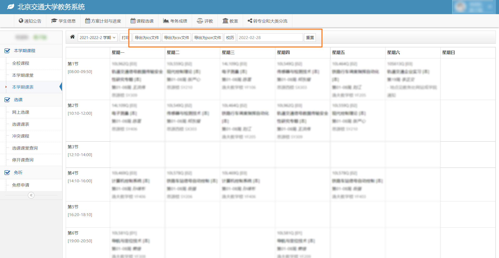

> 本仓库 fork 自 [ZiuChen/userscript](https://github.com/ZiuChen/userscript) 中的
> `src/userscript/BJTU-Schedule-ics-csvGenerator`（Greasy Fork [#430918](https://greasyfork.org/scripts/430918)），
> 原作者 [ZiuChen](https://github.com/ZiuChen)，以 MIT 协议发布。原作者的提交历史保留在本仓库中，
> 每个上游提交都带有 `Upstream-Commit:` 指向原仓库对应提交。

## 北交大iCalender课表生成

### 脚本功能：

* 在Win/Android/IOS日历中登录Outlook邮箱导入课表，导入一次，多端同步！
* 一键将课表导出为.ics文件，支持多端同步，与各系统原生日历应用完美结合。
* 一键将课表导出为.csv文件，可以在Excel中编辑。 
* 一键将课表导出为.json文件，可以导入第三方软件。 
* 自动从学校[校历页面](https://bksy.bjtu.edu.cn/Semester.html)获取每个教学周的准确日期，学期中间的整周放假会自动跳过，不再需要手工推算。

### 使用效果：



### 使用方法：

[北交大iCalender课表生成使用指南](https://www.cnblogs.com/ziuc/articles/15152630.html)

打开"本学期课表"或"选课课表"页面后，标题栏会出现：

* **学期下拉框**：决定用哪一学期的校历计算课程日期，默认自动选中当前学期；选错学期会导致日期整体错位。
* **刷新校历**：重新拉取校历数据（正常情况下 24 小时内使用本地缓存）。
* **起始周一**：仅在**校历抓取失败**时作为兜底，填本学期第一个教学周的周一（如 `2026-08-31`）。使用兜底路径时会失去"跳过放假周"的能力，因此脚本会在该日期距今天超过半年时弹窗提醒。
* **重置**：只清除脚本自己写入的 localStorage 键，不影响教务系统自身的数据。

### 注意事项：

错峰上课：在**思源西楼** 与 **逸夫教学楼**的部分节次上下课时间与标准时间不同，脚本会对这些教学楼使用另一套时间表（源码中的 `DELAY_CLASSROOMS` 与 `DELAY_TIME_TABLE`）。具体时间以开学时教务处公布为准，需要调整时修改这两个常量即可；`DELAY_CLASSROOMS` 为空数组时，所有日程都按标准时间导出。

CSV 导出是"节次 × 星期"的周视图，行标签固定为标准上课时间；错峰教学楼课程的实际时间只在 ICS 中体现，这是目前已知的局限（见 [ISSUES.md](ISSUES.md) 待处理项 A）。

目前仅对本科生 "选课课表" 与 "本学期课表" 两个网页做了支持，研究生选课界面尚未测试。

### 开发与测试：

```bash
node test/run-tests.js
```

测试脚本无第三方依赖：既用文本提取的方式把 `script.user.js` 中的纯函数（周次解析、上课时间计算、ICS 事件生成、CSV 生成）取出来做回归验证，也用 stub 的浏览器环境把整个脚本求值一遍，确认没有引用错误、异常提示路径正常。已知问题与处理状态记录在 [ISSUES.md](ISSUES.md)，后续计划见 [todo.md](todo.md)。

### 后续开发计划：

支持自定义日程描述部分格式；

使用过程中如遇到任何问题，欢迎到[脚本主页](https://greasyfork.org/zh-CN/scripts/430918)或[Github](https://github.com/ZiuChen/userscript)提交建议！
